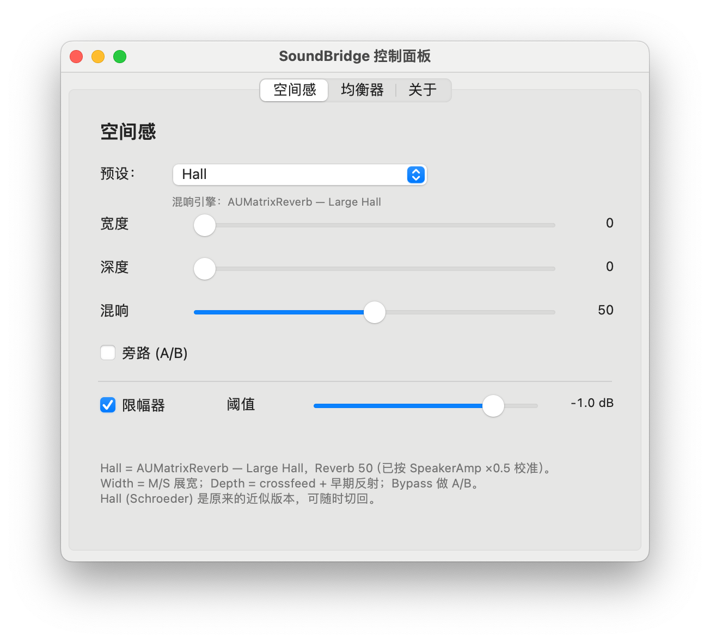

# SoundBridge

A macOS menu bar audio bridge for HDMI / DisplayPort displays.

SoundBridge creates a virtual output device, gives it native macOS volume and
mute controls, applies EQ and spatial processing, and forwards the result to a
physical display output. It is built as a HAL (AudioServerPlugIn) driver plus a
Swift menu bar app and engine.



> Personal project, not affiliated with SpeakerAmp. SpeakerAmp was used only as
> an A/B reference while tuning the spatial effect.

## Why

macOS does not expose a volume control for most HDMI / DisplayPort audio
endpoints. A virtual output device can provide one, but a naive virtual driver
loses sound after clamshell sleep/wake because the physical endpoint is
destroyed and recreated with a new `AudioObjectID` (the UID stays the same).

SoundBridge follows the same general architecture as SpeakerAmp, but the
physical route is resolved by **UID**, never by a cached `AudioObjectID`.

## Features

- Virtual output device `SoundBridge` with native `VolumeScalar` / `Mute`
  properties
- System volume keys, native OSD, Control Center and mute key work without
  Accessibility permissions or media-key interception
- 10-band peaking EQ (50 Hz – 15 kHz, ±12 dB)
- Spatial effect: M/S widening, crossfeed, early reflections and Apple
  `AUMatrixReverb` (Large Hall), calibrated against SpeakerAmp Hall 50%
- Look-ahead limiter
- UID-based wake rebinding with debounce, backoff and silent standby
- Sleep-safe: `willSleep` pauses the watchdog; ring backlog is bounded after
  wake
- Shared-memory audio transport between plugin and engine: **no microphone
  permission**, no orange microphone indicator
- Menu bar icon with volume-following sound waves, control panel with
  Spatial / Equalizer / About tabs
- Chinese and English UI, following the system language or selectable manually
- Optional launch at login

## Architecture

```
macOS applications
        │
        ▼
SoundBridge virtual output device          (HAL plugin, /Library/Audio/Plug-Ins/HAL)
        │  native Volume / Mute properties
        ▼
shared-memory ring  (/tmp/soundbridge_ring_v1)
        │
        ▼
engine  (menu bar app)
   EQ  →  spatial  →  limiter
        │
        ▼
physical display output, resolved by UID   (HDMI / DisplayPort)
```

The HAL plugin only publishes the device, implements volume/mute, keeps a
loopback ring, and writes the post-volume mix into shared memory. DSP,
forwarding, clock-drift compensation and wake rebinding live in the engine.

### Wake / rebind

The engine:

- resolves the physical output by `kAudioDevicePropertyDeviceUID` every time
- listens to `kAudioHardwarePropertyDevices`,
  `kAudioDevicePropertyDeviceIsAlive`, `didWake` and `screensDidWake`
- survives the common “device rebuilt twice” sequence
- keeps the virtual device running while the physical endpoint is absent
- retries with backoff and a 1 s watchdog
- resets a large ring backlog with a short fade after wake to keep latency low

## Requirements

- macOS 14.0 or newer
- Apple Silicon (the driver is built for `arm64`)
- Xcode 15/16 command line tools (`swiftc`, `clang`, `codesign`, `pkgbuild`)
- A physical HDMI / DisplayPort output. Tested with:
  - MacBook Air M3, macOS 14.6
  - LECOO M3221PL, DisplayPort, 2ch / 48 kHz

SpeakerAmp is not required. It can remain installed as a fallback.

## Install

### PKG (recommended)

Build the two local packages:

```bash
git clone https://github.com/jerryforgit/SoundBridge.git
cd SoundBridge
./packaging/build.sh
```

This produces:

```
packaging/build/SoundBridge.pkg              # app + HAL plugin
packaging/build/Uninstall SoundBridge.pkg    # clean uninstall
```

Install:

```bash
open "packaging/build/SoundBridge.pkg"
# or
sudo installer -pkg "packaging/build/SoundBridge.pkg" -target /
```

The installer copies:

- `/Applications/SoundBridge.app`
- `/Library/Audio/Plug-Ins/HAL/SoundBridge.driver`

and restarts `coreaudiod` (audio is interrupted for 2–3 seconds).

### Manual developer build

```bash
./driver/build.sh
./app/build.sh
./scripts/install.sh          # sudo; installs the HAL plugin only
open app/build/SoundBridge.app
```

`scripts/install.sh` and `scripts/uninstall.sh` only manage the HAL plugin.
They do not touch the app bundle.

### First launch

Open `SoundBridge.app`. The menu bar shows a speaker icon and a percentage.
Clicking the icon opens the status menu and, like SpeakerAmp, switches the
system default output to `SoundBridge` (can be disabled in the menu).

No microphone permission is requested. If an older build left a stale grant:

```bash
tccutil reset Microphone com.jerry.soundbridge
```

## Usage

- **Status menu**: volume slider, mute, control panel, spatial/EQ bypass,
  output device, default-output toggle, launch at login, language, engine log
- **Control panel** (`Control panel…`):
  - **Spatial**: preset, width, depth, reverb, A/B bypass, limiter
  - **Equalizer**: 10 vertical bands, presets, bypass, Flat reset
  - **About**: project/architecture notes
- **Volume keys / OSD**: native, because the virtual device implements the
  standard volume properties
- **Output device**: choose another HDMI/DisplayPort/USB/built-in output in the
  status menu. The engine rebinds by UID.
- **Language**: system default, 中文 or English. The control panel is recreated
  when the language changes.
- **Launch at login**: `SMAppService` from the status menu.

### Spatial presets

- `Hall` — Apple `AUMatrixReverb` Large Hall, wet 50 (×0.5 calibrated to
  SpeakerAmp's Hall 50%)
- `SpeakerAmp (Medium Hall)` — same AU, Medium Hall, for A/B
- `Hall (Schroeder)` — earlier built-in approximation
- Standard / Movie / Music / Night — lighter built-in spatial settings

## Uninstall

### PKG (recommended)

```bash
open "packaging/build/Uninstall SoundBridge.pkg"
# or
sudo installer -pkg "packaging/build/Uninstall SoundBridge.pkg" -target /
```

It quits the app, unregisters its login item, removes the app, HAL plugin,
shared memory, preferences and logs, then restarts `coreaudiod` and Dock.
SpeakerAmp / BlackHole / MAXHUB are untouched.

### Manual

```bash
./scripts/uninstall.sh        # removes the HAL plugin
# then quit the app and move /Applications/SoundBridge.app to the Trash
sudo rm -f /tmp/soundbridge_ring_v1
```

## Project layout

| Path | Contents |
|---|---|
| `driver/SoundBridge` | C++ AudioServerPlugIn (libASPL-based) |
| `driver/third_party/libASPL` | vendored MIT-licensed AudioServerPlugIn helper |
| `engine/` | Swift engine: CoreAudio routing, wake rebinding, DSP, shared memory |
| `app/` | AppKit menu bar app, control panel, icon generator |
| `packaging/` | `pkgbuild` scripts for install/uninstall packages |
| `scripts/` | developer install/uninstall for the HAL plugin |
| `wakespike/` | standalone UID-rebind wake-test harness |
| `tools/` | small CoreAudio device/default-output tools |
| `docs/` | environment, test results and reference notes |
| `SPEC.md` | original design brief and acceptance criteria |

## Troubleshooting

**No sound**

1. Check that the system default output is `SoundBridge`.
2. Pause/play the video or music once. Some browsers keep an old audio stream
   after the default output changes.
3. Check the status menu: the engine should say “running”.
4. Tail the log:

```bash
tail -f ~/Library/Logs/SoundBridge/engine.log
```

A healthy start looks like:

```
shared memory: available
reconcile: input=shared output=...
OUTPUT STARTED ...
```

**The HAL plugin is not loaded**

```bash
ls /Library/Audio/Plug-Ins/HAL/SoundBridge.driver
sudo killall coreaudiod
```

**Wake recovery**

Look for:

```
output REBIND: old id=... -> new id=... (uid unchanged)
OUTPUT STARTED ...
```

**Gatekeeper / PKG**

The app and plugin use ad-hoc signatures; the PKGs are unsigned. For local use,
right-click the package and choose Open, or use `sudo installer`.

## Known limitations

- Ad-hoc signed / not notarized; intended for personal use
- No Intel build
- CPU around 2.5% on an M3 with AUMatrixReverb enabled (slightly above the 2%
  original target); the reverb is the dominant cost
- The spatial effect is calibrated by ear against SpeakerAmp; it is not
  bit-identical to SpeakerAmp's processing
- The shared-memory ring is a local file in `/tmp`; all audio stays on the
  machine
- No App Store distribution

## Testing status

- 10/10 clamshell sleep/wake recoveries with the shared-memory transport
- 2-hour continuous playback: RSS stable at ~20 MB, no errors, ring median
  512 frames
- Uninstall removes driver/device/process and restores system audio
- No microphone permission or orange microphone indicator

See [`docs/TEST-RESULTS.md`](docs/TEST-RESULTS.md) and
[`docs/ENVIRONMENT.md`](docs/ENVIRONMENT.md).

## License

MIT. See [`LICENSE`](LICENSE) and
[`THIRD_PARTY_NOTICES.md`](THIRD_PARTY_NOTICES.md).

---

## 中文简介

SoundBridge 是一个 macOS 菜单栏音频工具：创建虚拟输出设备，把声音转发到显示器
的 HDMI / DisplayPort 端点，同时提供原生音量键 / OSD、10 段 EQ、空间感和
UID 唤醒重绑。

- 插件与 App 分离：HAL 插件负责虚拟设备和共享内存，App 负责 DSP 和转发
- 唤醒按 UID 重绑，不缓存 `AudioObjectID`
- 共享内存传输，**不需要麦克风权限**
- 安装：`./packaging/build.sh` 后打开 `packaging/build/SoundBridge.pkg`
- 卸载：打开 `packaging/build/Uninstall SoundBridge.pkg`
- SpeakerAmp 不会被卸载，可随时作为回退
