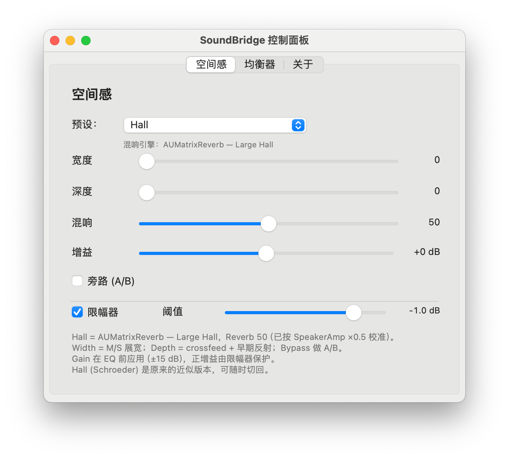
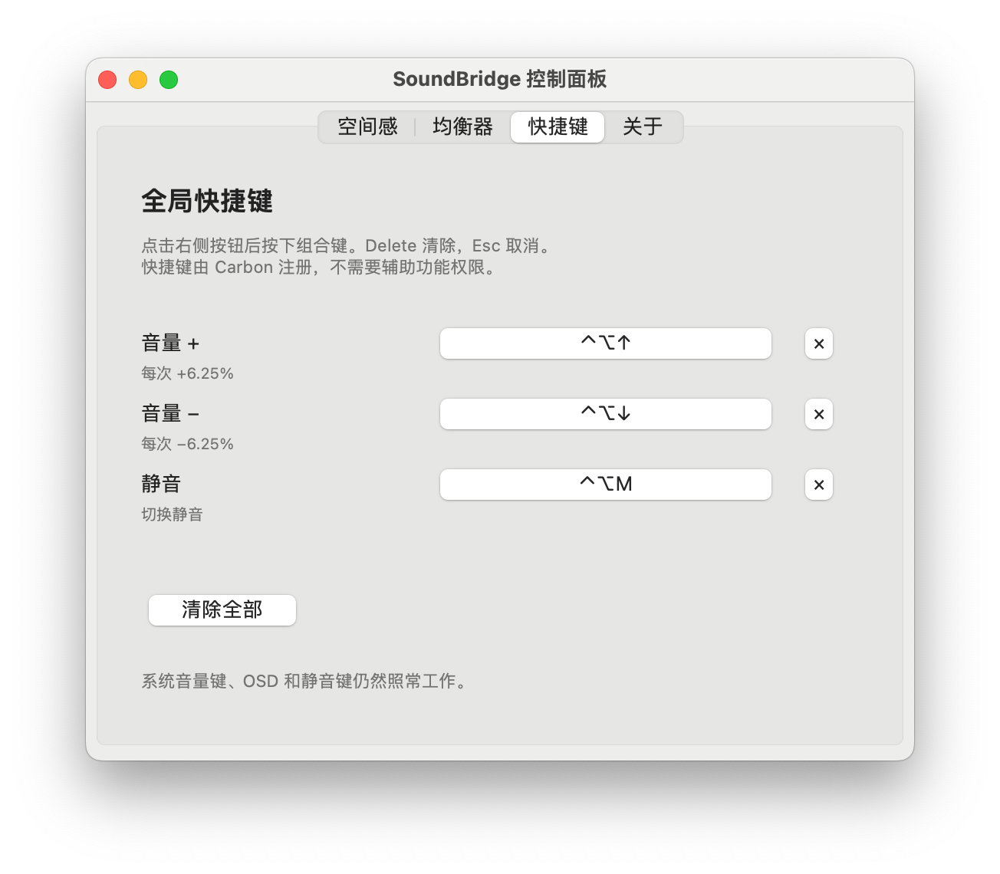

# SoundBridge

[English](README.md) | **简体中文**

一个用于 HDMI / DisplayPort 显示器的 macOS 菜单栏音频桥接工具。

SoundBridge 创建一个虚拟输出设备，提供 macOS 原生音量和静音控制，加入 EQ 与
空间感处理，再把声音转发到物理显示器输出。它由 HAL（AudioServerPlugIn）驱动、
Swift 菜单栏 App 和音频引擎组成。



> 个人项目，与 SpeakerAmp 无关联。SpeakerAmp 仅作为空间感调校时的 A/B 参考。

## 为什么需要它

macOS 对大多数 HDMI / DisplayPort 音频端点不提供音量控制。虚拟输出设备可以
补上这个能力，但普通的虚拟驱动在合盖睡眠 / 唤醒后会丢声音，因为物理端点会被
销毁并用新的 `AudioObjectID` 重建（UID 保持不变）。

SoundBridge 沿用与 SpeakerAmp 类似的结构，但物理输出始终按 **UID** 解析，
绝不缓存 `AudioObjectID`。

## 功能

- 虚拟输出设备 `SoundBridge`，实现原生 `VolumeScalar` / `Mute` 属性
- 系统音量键、原生 OSD、控制中心和静音键直接可用，不需要辅助功能权限，
  也不拦截媒体键
- 10 段峰值 EQ（50 Hz – 15 kHz，±12 dB）
- 前置增益 −15…+15 dB，在 EQ 前应用，由限幅器保护
- 可录制的全局快捷键：音量 +、音量 −、静音（Carbon
  `RegisterEventHotKey`，不需要辅助功能权限）
- 空间感：M/S 展宽、crossfeed、早期反射，以及 Apple `AUMatrixReverb`
  （Large Hall），已和 SpeakerAmp Hall 50% 校准
- Look-ahead 限幅器
- 唤醒时按 UID 重绑，带防抖、退避和静默待命
- 睡眠安全：`willSleep` 期间暂停 watchdog；唤醒后限制 ring 积压
- 插件与引擎之间使用共享内存传输：**不需要麦克风权限**，不会出现橙色麦克风
  指示器
- 菜单栏图标声波跟随音量；控制面板包含 空间感 / 均衡器 / 快捷键 / 关于
- 中英文界面，可跟随系统或手动切换
- 可选登录时启动

## 架构

```
macOS 应用
        │
        ▼
SoundBridge 虚拟输出设备                  （HAL 插件，/Library/Audio/Plug-Ins/HAL）
        │  原生 Volume / Mute 属性
        ▼
共享内存 ring  (/tmp/soundbridge_ring_v1)
        │
        ▼
引擎（菜单栏 App）
   EQ  →  空间感  →  限幅器
        │
        ▼
物理显示器输出，按 UID 解析                  （HDMI / DisplayPort）
```

HAL 插件只负责发布设备、实现音量 / 静音、维护 loopback ring，并把经过音量的
混音写入共享内存。DSP、转发、时钟漂移补偿和唤醒重绑都在引擎里。

### 唤醒 / 重绑

引擎会：

- 每次都通过 `kAudioDevicePropertyDeviceUID` 解析物理输出
- 监听 `kAudioHardwarePropertyDevices`、
  `kAudioDevicePropertyDeviceIsAlive`、`didWake` 和 `screensDidWake`
- 处理常见的“设备连续重建两次”
- 物理端点消失时保持虚拟设备继续运行
- 退避重试，并带 1 秒 watchdog
- 唤醒后如果 ring 积压过大，短暂淡入并跳到目标位置，避免高延迟

## 系统要求

- macOS 14.0 或更新
- Apple Silicon（驱动按 `arm64` 构建）
- Xcode 15/16 命令行工具（`swiftc`、`clang`、`codesign`、`pkgbuild`）
- 一个物理 HDMI / DisplayPort 输出。测试环境：
  - MacBook Air M3，macOS 14.6
  - LECOO M3221PL，DisplayPort，2 声道 / 48 kHz

不需要安装 SpeakerAmp；它可以保留作为回退。

## 安装

### PKG（推荐）

构建两个安装包：

```bash
git clone https://github.com/jerryforgit/SoundBridge.git
cd SoundBridge
./packaging/build.sh
```

产物：

```
packaging/build/SoundBridge.pkg              # App + HAL 插件
packaging/build/Uninstall.SoundBridge.pkg    # 彻底卸载
```

安装：

```bash
open "packaging/build/SoundBridge.pkg"
# 或
sudo installer -pkg "packaging/build/SoundBridge.pkg" -target /
```

安装器会复制：

- `/Applications/SoundBridge.app`
- `/Library/Audio/Plug-Ins/HAL/SoundBridge.driver`

并重启 `coreaudiod`（声音会中断 2–3 秒）。

### 开发方式手动构建

```bash
./driver/build.sh
./app/build.sh
./scripts/install.sh          # 需要 sudo，只安装 HAL 插件
open app/build/SoundBridge.app
```

`scripts/install.sh` 和 `scripts/uninstall.sh` 只管理 HAL 插件，不会动 App。

### 首次启动

打开 `SoundBridge.app`。菜单栏会出现喇叭图标和百分比。点击图标会打开状态栏菜单，
并像 SpeakerAmp 一样把系统默认输出切到 `SoundBridge`（可在菜单中关闭）。

不会请求麦克风权限。如果旧版本留下过授权，可以清理：

```bash
tccutil reset Microphone com.jerry.soundbridge
```

## 使用

- **状态栏菜单**：音量滑块、静音、控制面板、空间感 / EQ 旁路、输出设备、
  默认输出开关、登录时启动、语言、引擎日志
- **控制面板**（`控制面板…`）：
  - **空间感**：预设、宽度、深度、混响、前置增益、A/B 旁路、限幅器
  - **均衡器**：10 个垂直频段、预设、旁路、Flat 重置
  - **快捷键**：音量 +、音量 −、静音
  - **关于**：项目 / 架构说明
- **音量键 / OSD**：原生可用，因为虚拟设备实现了标准音量属性
- **输出设备**：在状态栏菜单里选择其他 HDMI/DisplayPort/USB/内置输出，引擎会按
  UID 重绑
- **语言**：跟随系统、中文或 English。切换语言会重建控制面板
- **登录时启动**：使用 `SMAppService`，显示在 系统设置 → 通用 → 登录项 →
  **登录时打开**。安装器会在替换 App 前注销旧 build 的登录项，新 build 在开启
  该偏好后首次启动时重新注册

### 空间感预设

- `Hall` — Apple `AUMatrixReverb` Large Hall，wet 50（按 SpeakerAmp Hall 50%
  ×0.5 校准）
- `SpeakerAmp (Medium Hall)` — 同一个 AU 的 Medium Hall，用于 A/B
- `Hall (Schroeder)` — 早期内置近似版本
- Standard / Movie / Music / Night — 更轻量的内置空间感

### 全局快捷键



- **音量 +**、**音量 −**（每次 1/16 = 6.25%）和 **静音**
- 点击录制按钮后按下组合键
- `Delete` 清除，`Esc` 取消录制
- 默认不设置；系统音量键 / OSD 仍然照常工作
- 使用 Carbon `RegisterEventHotKey` 注册，**不需要辅助功能权限**
- 自定义快捷键不会触发系统 OSD，菜单栏百分比会更新

## 卸载

### PKG（推荐）

```bash
open "packaging/build/Uninstall.SoundBridge.pkg"
# 或
sudo installer -pkg "packaging/build/Uninstall.SoundBridge.pkg" -target /
```

它会退出 App、注销登录项、删除 App、HAL 插件、共享内存、偏好设置和日志，然后
重启 `coreaudiod` 和 Dock。SpeakerAmp / BlackHole / MAXHUB 不会被修改。

### 手动

```bash
./scripts/uninstall.sh        # 删除 HAL 插件
# 然后退出 App，把 /Applications/SoundBridge.app 移到废纸篓
sudo rm -f /tmp/soundbridge_ring_v1
```

## 项目结构

| 路径 | 内容 |
|---|---|
| `driver/SoundBridge` | C++ AudioServerPlugIn（基于 libASPL） |
| `driver/third_party/libASPL` | vendored MIT 许可的 AudioServerPlugIn helper |
| `engine/` | Swift 引擎：CoreAudio 路由、唤醒重绑、DSP、共享内存 |
| `app/` | AppKit 菜单栏 App、控制面板、图标生成 |
| `packaging/` | 安装 / 卸载 PKG 的 `pkgbuild` 脚本 |
| `scripts/` | 开发用的 HAL 插件安装 / 卸载 |
| `wakespike/` | 独立的 UID 重绑唤醒测试工具 |
| `tools/` | 小型 CoreAudio 设备 / 默认输出工具 |
| `docs/` | 环境、测试结果和参考记录 |
| `SPEC.md` | 原始设计说明和验收标准 |

## 常见问题

**没有声音**

1. 确认系统默认输出是 `SoundBridge`
2. 暂停 / 继续一次视频或音乐。有些浏览器在默认输出变化后会保留旧音频流
3. 看状态栏菜单，引擎应显示“运行中”
4. 查看日志：

```bash
tail -f ~/Library/Logs/SoundBridge/engine.log
```

正常启动日志类似：

```
shared memory: available
reconcile: input=shared output=...
OUTPUT STARTED ...
```

**HAL 插件没有加载**

```bash
ls /Library/Audio/Plug-Ins/HAL/SoundBridge.driver
sudo killall coreaudiod
```

**唤醒后没有声音**

查找：

```
output REBIND: old id=... -> new id=... (uid unchanged)
OUTPUT STARTED ...
```

**Gatekeeper / PKG**

App 和插件使用 ad-hoc 签名，PKG 未签名。自用场景下可以右键点击安装包选择
“打开”，或使用上面的 `sudo installer`。

## 已知限制

- Ad-hoc 签名 / 未公证，面向个人使用
- 没有 Intel 构建
- M3 上开启 `AUMatrixReverb` 时 CPU 约 2.5%（略高于最初 2% 的目标），混响是
  主要成本
- 空间感是凭听感对 SpeakerAmp 校准的，不是逐位一致
- 共享内存 ring 是 `/tmp` 下的本地文件，所有音频都留在这台机器上
- 不通过 App Store 分发

## 验收状态

- 共享内存版本合盖睡眠 / 唤醒 10/10 次恢复
- 连续播放 2 小时：RSS 稳定在约 20 MB，无错误，ring 中位数 512 帧
- 前置增益：−6 dB 实测 0.5012×，+6 dB 实测 1.9953×；+15 dB 被限幅器限制在
  −1 dBFS
- 快捷键：录制、Carbon 注册、音量 ± / 静音动作和重启后持久化均已验证；
  未请求辅助功能权限
- 登录项显示在「登录时打开」，卸载后移除
- 卸载会删除驱动 / 设备 / 进程，并恢复系统音频
- 不需要麦克风权限，没有橙色麦克风指示器

详见 [`docs/TEST-RESULTS.md`](docs/TEST-RESULTS.md) 和
[`docs/ENVIRONMENT.md`](docs/ENVIRONMENT.md)。

## 许可证

MIT。见 [`LICENSE`](LICENSE) 和 [`THIRD_PARTY_NOTICES.md`](THIRD_PARTY_NOTICES.md)。
